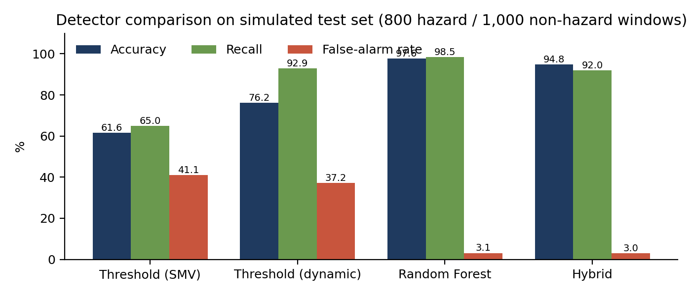
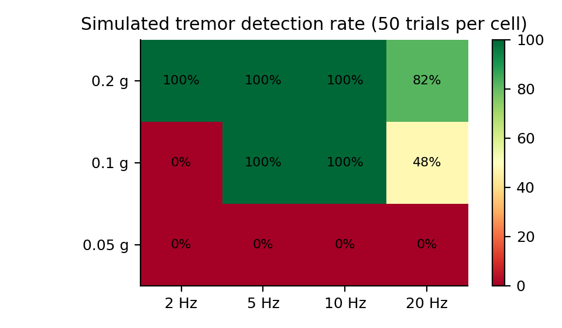
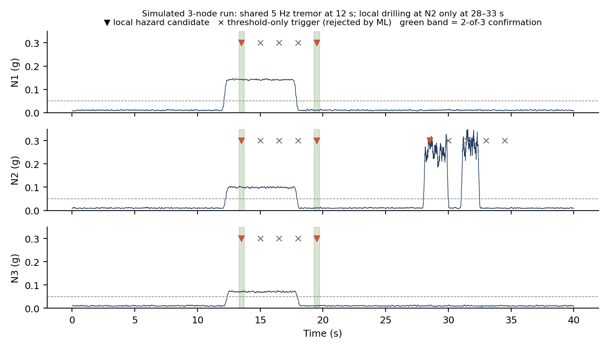

# Hybrid Edge-AI Mine Tremor Detection — Simulation Study

[](https://github.com/RakshitRPathak/Mining-tremor-detection-Patent-cum-grant/actions/workflows/ci.yml)

Software simulation of a distributed, edge-AI tremor detection system for underground mines. Each sensor node (ESP32 + MPU6050 IMU) classifies vibration with a Random Forest, validates the prediction against physical thresholds (hybrid validation), and a hazard is confirmed only when multiple nodes agree (multi-node consensus).

> **Important:** every result in this repository comes from **synthetic signals**. The simulations validate the detection and firmware logic under controlled conditions. They are not hardware or field measurements, and performance on real mine vibration is expected to be lower.

## Pipeline

```
IMU sensing → preprocessing → feature extraction → Random Forest → hybrid validation → multi-node confirmation → alert
```

## Repository structure

```
├── src/
│   ├── tremor_simulation.py                 # Stage 1: binary model, detector comparison, threshold sweep, consensus
│   ├── streaming_and_firmware_simulation.py # Stage 2: streaming detection, latency, firmware fault injection
│   └── extended_analysis_simulation.py      # Stage 3: 4-class model, 3-node event log, figures
├── results/                                 # JSON outputs from each stage
├── figures/                                 # PNG figures generated by Stage 3
├── run_all.sh                               # Runs all three stages in order
└── requirements.txt
```

## Quick start

```bash
pip install -r requirements.txt
bash run_all.sh
```

Tests: `pip install pytest && python -m pytest -q` (15 tests, about 2 s: signal generators, the gravity-removed envelope, and a check that every number in this README matches `results/`). `python -m pytest -q -m slow` re-runs stage 1 and confirms it reproduces the committed results exactly.

The stages depend on each other, so run them in order (`run_all.sh` does this). To run one manually, work from `src/`: `cd src && python tremor_simulation.py`. Fixed random seeds make every number reproducible. A full run takes a few minutes on a laptop.

## Simulation setup

| Parameter | Value |
| --- | --- |
| Sampling | 100 Hz, 3-axis accelerometer, gravity 1 g on Z, 6 mg rms noise |
| Window | 3 s, 50% overlap (1.5 s hop) |
| Model | Random Forest, 50 trees, max depth 10, 14 features |
| Threshold layer | Gravity-removed dynamic acceleration envelope ≥ 0.05 g for ≥ 0.3 s |
| Consensus | 2 of 3 nodes within 2 s |

| Class | Signal model |
| --- | --- |
| Tremor (hazard) | Tapered sinusoidal burst, 2–20 Hz, 0.02–0.8 g |
| Rockburst (hazard) | Decaying impulse, 5–30 Hz, 0.3–2.5 g |
| Drilling | Intermittent ramped bursts, 8–40 Hz |
| Machinery | Continuous sinusoid + harmonic, 8–45 Hz |
| Handling, footsteps, baseline | Spikes, periodic pulses, sensor noise |

## Key results (simulated)

| Detector | Accuracy | Recall | False-alarm rate |
| --- | --- | --- | --- |
| Threshold on SMV only | 61.6% | 65.0% | 41.1% |
| Threshold on dynamic envelope | 76.2% | 92.9% | 37.2% |
| Random Forest only | 97.6% | 98.5% | 3.1% |
| Hybrid (RF AND threshold) | 94.8% | 92.0% | 3.0% |

- **4-class model** (Normal / Minor vibration / Major tremor / Structural disturbance): 98.2% accuracy, macro F1 0.982.
- **Multi-node consensus:** 86.3% of shared events confirmed; 0% false confirmations from local disturbances or a faulty node.
- **Detection latency:** 1.08 s median; 93.3% of detections within 2 s.
- **Firmware fault injection:** event delivery 60.0% (current) vs 99.9% (with sensor retry, watchdog and event queue), under assumed fault rates.





## Findings that changed the design

- Signal-magnitude (SMV) thresholds miss vibration perpendicular to gravity; the gravity-removed dynamic envelope fixes this.
- Continuous drilling produced 272 false alerts per hour in streaming mode, the main open problem. Multi-node consensus suppresses it when drilling is local to one node.
- Windows fully inside long tremors were classified as machinery; training needs long-duration tremor examples.
- A 3 s alert cooldown caused duplicate alerts on 60% of long tremors; 15 s removed them.
- Tremors of 0.05 g were not detected; the practical floor is about 0.1–0.2 g depending on frequency.

## Limitations

Synthetic classes are cleanly separated and noise is idealised. The simulation does not model real mine tremor spectra, rock-mass propagation, sensor mounting, radio behaviour underground, network latency or power consumption. Next steps are bench tests with a vibration rig, training on real recordings (including drilling), and a physical three-node deployment.
